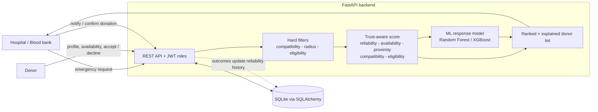
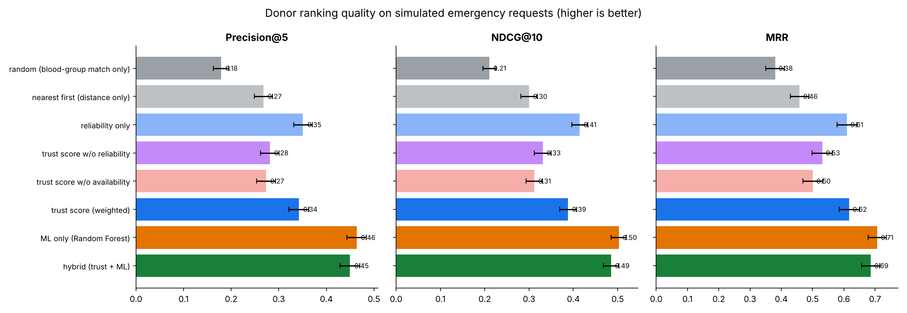

# TrustBlood - Trust-Aware Recommendation of Emergency Blood Donors

> **Major Project (Phase-I -> working prototype)** - B.Tech Computer Science and Engineering, Session 2026-27  
> School of Computer Science and Engineering, **IILM University, Greater Noida**  
> Guide: **Mrs. Madhavi Tripathi**

[](https://github.com/aniketkumar5182-ui/trust-aware-blood-donor-recommender/actions/workflows/ci.yml)


| Team member | Roll no. |
|---|---|
| Aniket Kumar | 2410031618 |
| Aditya Pandey | 2410031650 |
| Shivam Raj | 2410031707 |
| Divyanshu Kumar | 2410031735 |

---

## 1. The problem

In a medical emergency a blood-group match alone does not tell you whether a registered donor is **currently
available, reachable, eligible, or likely to respond**. Static donor lists, phone trees and public appeals waste
precious time on donors who are far away, recently donated, inactive or simply unresponsive.

## 2. The idea

TrustBlood treats **reliability** and **availability** as *first-class* ranking signals instead of afterthoughts:

1. **Hard filters** - blood-group compatibility, search radius, basic eligibility (age, weight, donation interval, consent).
2. **Trust-aware score** - a transparent weighted score of
   *reliability* (response rate, follow-through, activity, experience),
   *availability* (self-reported status, recent activity, response speed),
   *proximity*, *compatibility* and *eligibility margin*. Weights adapt to request **urgency**.
3. **Optional ML layer** - a Random Forest (or XGBoost) predicts the probability that a contacted donor will
   actually donate; it can be used alone or blended with the weighted score (`hybrid`).
4. **Explainable output** - every recommended donor comes with a per-component score breakdown and plain-language reasons.
5. **Feedback loop** - donor replies and hospital-confirmed donations update the donor's reliability history.



## 3. Quick start

Requires **Python 3.11+**.

```bash
git clone https://github.com/aniketkumar5182-ui/trust-aware-blood-donor-recommender.git
cd trust-aware-blood-donor-recommender

python -m venv .venv
source .venv/bin/activate            # Windows: .venv\Scripts\activate
pip install -r requirements.txt

python -m scripts.train_model        # trains the response model on synthetic data (a few seconds)
python -m scripts.seed_demo          # demo accounts + 400 synthetic donors
uvicorn app.main:app --reload
```

Open **http://127.0.0.1:8000/** for the dashboard and **http://127.0.0.1:8000/docs** for the interactive API docs.

Demo logins (created by `seed_demo`, **local demo only**; password `Demo@12345`):

| Role | Email |
|---|---|
| Hospital | `hospital@example.com` |
| Donor | `donor@example.com` |
| Admin | `admin@example.com` |

### Try the full flow in 2 minutes

1. Log in as **hospital** -> create a request (e.g. `A-`, *critical*, Greater Noida) -> **Find donors**.
2. Expand *Why this score?* on any donor; switch the **Ranking** mode between `weighted`, `ml` and `hybrid`.
3. Tick a few donors -> **Notify selected donors**.
4. In another browser/private window log in as **donor** (`donor@example.com`), create a profile that matches
   (same blood group/city, consent ticked) and request again - then **Accept** the request.
5. Back as hospital: **Refresh** -> **Mark donated**. The donor's reliability history is updated and they become
   ineligible for the next request until the donation interval has passed.

### Configuration

Copy `.env.example` to `.env` (loaded automatically) or set environment variables:
`SECRET_KEY`, `ADMIN_EMAIL`, `ADMIN_PASSWORD`, `DATABASE_URL`, `TOKEN_EXPIRE_MINUTES`.
Without `SECRET_KEY` a random key is generated on every start (logins then expire on restart).

### Docker

```bash
cp .env.example .env     # edit the values
docker build -t trustblood .
docker run -p 8000:8000 --env-file .env trustblood
```

## 4. How the trust score works

```
score = w_rel * reliability + w_avail * availability + w_prox * proximity
      + w_comp * compatibility + w_elig * eligibility_margin
```

| Urgency | reliability | availability | proximity | compatibility | eligibility |
|---|---:|---:|---:|---:|---:|
| normal   | 0.30 | 0.25 | 0.20 | 0.15 | 0.10 |
| urgent   | 0.28 | 0.30 | 0.25 | 0.10 | 0.07 |
| critical | 0.25 | 0.33 | 0.30 | 0.07 | 0.05 |

* **Reliability** = 0.35 response rate + 0.30 follow-through + 0.20 long-term activity + 0.15 experience  
  (rates are Laplace-smoothed, so a new donor starts at a neutral 0.5 instead of 0 or 1).
* **Availability** = 0.45 status + 0.30 recent activity + 0.25 response speed.
* **Proximity** = `exp(-distance / 20 km)`; donors beyond the search radius are removed first.

Full formulas and design rationale: [`docs/SCORING_METHODOLOGY.md`](docs/SCORING_METHODOLOGY.md).

## 5. Evaluation (synthetic data)

Real donor-response data is sensitive and unavailable, so the system is evaluated on a **simulated** population
(1 500 donors, one year of outreach history, 500 emergency requests). The recommender never sees each donor's hidden
"true reliability" - only noisy history-based indicators - and all rankers are compared on the *same* candidates and
*same* sampled outcomes. A donor counts as a success if they respond, accept **and** actually donate.

| Method | P@5 | NDCG@10 | MRR | Contacts until first donor (lower = better) |
|---|---:|---:|---:|---:|
| Blood-group match only (random order) | 0.179 | 0.211 | 0.380 | 5.65 |
| Nearest first (distance only) | 0.268 | 0.300 | 0.459 | 4.22 |
| Reliability only | 0.351 | 0.414 | 0.610 | 2.68 |
| **Trust score (weighted)** | 0.342 | 0.388 | 0.617 | 2.91 |
| **ML only (Random Forest)** | **0.463** | **0.503** | **0.707** | **2.02** |
| Hybrid (trust + ML) | 0.450 | 0.485 | 0.686 | 2.10 |



**What this does and does not show**

* Ranking by the trust indicators finds a willing donor in roughly **half as many contacts** as a blood-group-only
  list (2.9 vs 5.7) and clearly beats nearest-first ranking.
* Ablations support the thesis: removing *reliability* (P@5 0.281) or *availability* (0.273) from the score hurts a lot.
* The weighted score is **not uniformly better than reliability alone** in this simulation (the 95 % CIs overlap) - the
  value of the weighted score is that it also encodes proximity, urgency and eligibility, and stays explainable.
* The ML model reaches ROC-AUC ~0.70 on a time-ordered hold-out - useful but modest, as expected for noisy behaviour.
* The pipeline (filter + score + rank 1 500 donors) takes about **4 ms** per request.
* **These are simulation results, not real-world performance.** The simulator's ground truth was designed by us, so
  validation on real, authorised data is the main item of future work.

Reproduce: `python -m scripts.train_model && python -m scripts.evaluate` -> [`docs/RESULTS.md`](docs/RESULTS.md).

## 6. API overview

Interactive docs at `/docs`. Roles: **donor**, **hospital**, **admin**.

| Method & path | Role | Purpose |
|---|---|---|
| `POST /auth/register` | public | Create a *donor* account |
| `POST /auth/login` | public | Get a bearer token |
| `POST /auth/users` | admin | Create hospital / admin accounts |
| `POST/GET/PUT/DELETE /donors/me` | donor | Manage own profile (DELETE = erase all my data) |
| `PUT /donors/me/availability` | donor | `available` / `flexible` / `busy` / `unavailable` |
| `GET /donors/me/notifications` | donor | Requests sent to me |
| `POST /requests` | hospital, admin | Raise an emergency request |
| `GET /requests/{id}/recommendations` | hospital, admin | **Ranked donors** (`mode=auto\|weighted\|ml\|hybrid`, `top_k`, `include_excluded`) |
| `POST /requests/{id}/notify` | hospital, admin | Contact chosen donors (only eligible candidates allowed) |
| `POST /notifications/{id}/respond` | donor | Accept / decline |
| `POST /notifications/{id}/donation` | hospital, admin | Confirm donated / no-show (updates reliability) |
| `POST /admin/seed-demo`, `GET /admin/stats`, `GET /admin/model` | admin | Demo data, statistics, model info |

## 7. Project layout

```
app/
  compatibility.py   ABO/Rh rules                 scoring.py      reliability / availability / proximity
  eligibility.py     age, weight, interval        recommender.py  filter -> score -> rank (+ explanations)
  geo.py             haversine, bounding box      ml_model.py     Random Forest / XGBoost wrapper
  simulation.py      synthetic world + offline evaluation
  database.py, db_models.py, schemas.py, auth.py, notifier.py, model_registry.py
  routes/            auth, donors, requests, admin
  static/index.html  single-page dashboard (hospital, donor, admin views)
scripts/             train_model.py - evaluate.py - seed_demo.py
tests/               46 tests (rules, scoring, recommender, simulation, full API flow)
docs/                synopsis, architecture, scoring method, privacy & ethics, results
```

## 8. Mapping to the Phase-I synopsis

| Synopsis item | Where it is implemented |
|---|---|
| Blood-group compatibility & eligibility filtering | `app/compatibility.py`, `app/eligibility.py` |
| Availability estimation, reliability scoring, composite trust score | `app/scoring.py`, weights in `app/config.py` |
| Weighted scoring first, then Random Forest / XGBoost | `app/ml_model.py`, `scripts/train_model.py` |
| Interpretable score / feature-contribution view | `Recommendation.contributions`, dashboard *Why this score?*, `/admin/model` feature importances |
| Donor registration, profile management | `app/routes/donor_routes.py` |
| Emergency-request workflow, notifications, request status | `app/routes/request_routes.py`, `app/notifier.py` |
| Hospital / donor / admin interfaces | `app/static/index.html` |
| Precision@K, Recall@K, ranking quality, retrieval time | `app/simulation.py`, `scripts/evaluate.py` |
| Authentication, role-based authorisation, data minimisation | `app/auth.py`, `app/schemas.py`, [`docs/PRIVACY_AND_ETHICS.md`](docs/PRIVACY_AND_ETHICS.md) |
| Out of scope (national blood-bank integration, clinical certification, transfusion decisions) | intentionally **not** implemented |

## 9. Testing

```bash
pip install -r requirements-dev.txt
python -m pytest            # 46 tests, ~30 s
```

## 10. Privacy, safety and limitations

* Hospitals see only a masked name (`Aarav K.`), city, distance and score - **never** phone numbers or coordinates.
* Donors are contacted only with explicit **consent**, can change availability at any time and can **delete all their data**.
* Passwords use salted PBKDF2-SHA256; tokens are signed JWTs; staff accounts cannot be self-registered; hospitals can
  only see their own requests; hospitals can only contact donors that passed the eligibility filters.
* Eligibility rules are **demo defaults, not clinical guidance**. A doctor decides final eligibility; this tool only
  prioritises whom to contact first.
* Limitations: synthetic evaluation, SQLite default, no SMS gateway (the notifier only logs), no rate limiting,
  no live traffic/ETA routing (straight-line distance), pickled ML model must come from a trusted source.

## 11. Future work

Real SMS/WhatsApp gateway; response-time prediction and "best time to contact"; traffic-aware ETA; blood-bank stock
awareness; validation on authorised real data; fairness checks across donor groups; rate limiting and audit logs;
PostgreSQL deployment.

## 12. References

See [`docs/PROJECT_SYNOPSIS.md`](docs/PROJECT_SYNOPSIS.md#references) for the full literature survey and reference list.

## License

MIT (see [`LICENSE`](LICENSE)). Academic prototype - **not a medical device**.
