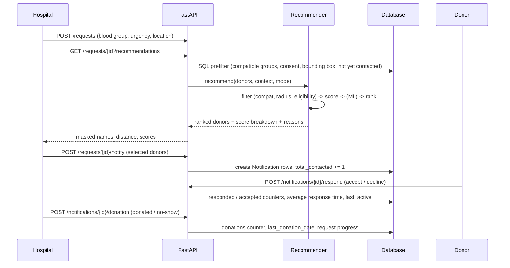
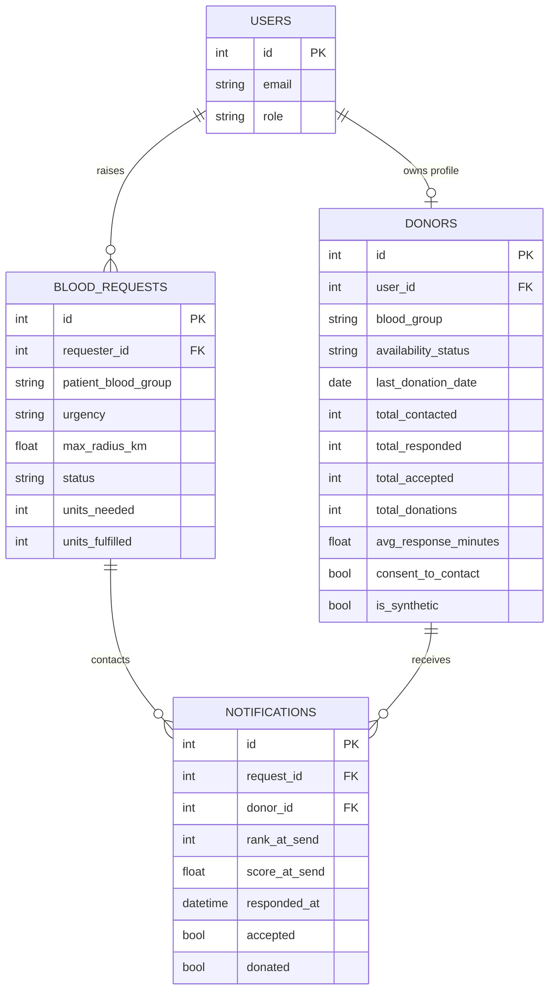

# Architecture

## Components

| Layer | Module(s) | Responsibility |
|---|---|---|
| Presentation | `app/static/index.html` | Single-page dashboard for hospitals, donors and admins (vanilla JS, no build step) |
| API | `app/main.py`, `app/routes/*` | REST endpoints, validation (Pydantic), role-based access |
| Security | `app/auth.py` | PBKDF2 password hashing, JWT bearer tokens, `require_roles` dependency |
| Domain engine | `app/compatibility.py`, `eligibility.py`, `geo.py`, `scoring.py`, `recommender.py` | Pure-Python, database-free ranking logic (easy to unit test) |
| ML | `app/ml_model.py`, `app/model_registry.py` | Train / persist / load the response-probability model |
| Persistence | `app/database.py`, `app/db_models.py` | SQLAlchemy 2 ORM (SQLite by default) |
| Simulation | `app/simulation.py`, `scripts/*` | Synthetic world, model training, offline evaluation |

The domain engine knows nothing about HTTP or SQL: routes convert ORM rows into `DonorProfile` dataclasses, call
`recommend()` and convert the result back to API schemas.

## Request flow

The last three steps form the **feedback loop**: real outcomes continuously refine every donor's reliability indicators.

## Data model

## Design decisions

* **Transparent first, ML second.** The weighted score is explainable and works with zero training data (cold start);
  ML is optional and falls back gracefully.
* **Filters before scores.** Medical/legal constraints are hard rules, never traded off against convenience.
* **Point-in-time features.** Training rows only use history available *before* each event.
* **Privacy by design.** Masked names, no phone/coordinates in ranking responses, consent flag, right to erasure,
  least-privilege roles (see `PRIVACY_AND_ETHICS.md`).
* **Scalability path.** A SQL bounding-box prefilter keeps the in-memory ranking set small; the engine takes ~4 ms for
  1 500 donors. For very large pools move the prefilter to PostGIS / a geo index.
